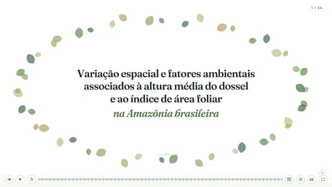

# Apresentação LAI — Amazônia brasileira

Apresentação científica interativa sobre a variação espacial e os fatores ambientais associados ao **Índice de Área Foliar (LAI)** na Amazônia brasileira. Desenvolvida em português, combina animações, esquemas didáticos, gráficos e mapas para apresentar conceitos de estrutura florestal e resultados de modelagem ambiental.

**[▶ Acessar a apresentação online](https://gustavohom.github.io/apresentacao_LAI/)**

[Repositório no GitHub](https://github.com/gustavohom/apresentacao_LAI) · [Perfil de Gustavo Mourão](https://github.com/gustavohom)



## Sobre o projeto

O trabalho apresentado tem como título **“Variação espacial e fatores ambientais associados à altura média do dossel e ao índice de área foliar na Amazônia brasileira”**. Esta apresentação concentra-se no LAI e em sua relação com a distribuição vertical das folhas, o sensoriamento remoto e as variáveis ambientais.

O material reúne **54 slides**, com etapas de animação controladas pelo apresentador, e pode ser usado em aulas, seminários e apresentações acadêmicas.

## Conteúdo

- Importância do LAI para fotossíntese, carbono, produtividade florestal, regulação hídrica e microclima.
- Conceitos de **LAI** (*Leaf Area Index*, Índice de Área Foliar) e **LAD** (*Leaf Area Density*, densidade de área foliar).
- Relação entre área foliar, área de solo, volume da copa e perfis verticais de folhas.
- Comparações entre árvores com o mesmo LAI e diferentes distribuições de LAD e alturas.
- Lei de **Beer-Lambert**, transmissão de luz e fração de lacunas no dossel.
- Medições com **LiDAR** e transectos do **Projeto EBA**.
- Amostragem na Amazônia e uso de **16 variáveis ambientais** como preditoras.
- Modelagem com **Random Forest**, desempenho do modelo e importância das variáveis.
- Interpretação dos resultados com **SHAP** e curvas de dependência.
- Extrapolação espacial e mapa contínuo de LAI da Amazônia.

Os dados, gráficos e mapas usados na apresentação estão incorporados aos arquivos do projeto. As animações mostram os conceitos e os resultados previamente preparados; o navegador não treina o modelo Random Forest.

## Recursos

- Animações em SVG e JavaScript, incluindo árvores, folhas, luz e cenas de LiDAR.
- Navegação por clique, teclado e barra de progresso.
- Painel de miniaturas com busca por título ou número do slide.
- Temas escuro e claro, com opção de maior contraste para projeção.
- Legendas explicativas opcionais.
- Modo de tela cheia.
- Personagens ilustrados e cenas de abertura e encerramento.

## Como assistir

Abra a [apresentação online](https://gustavohom.github.io/apresentacao_LAI/) em um navegador atualizado. Clique na área da apresentação ou use os atalhos abaixo para avançar pelas etapas.

| Ação | Controle |
| --- | --- |
| Avançar uma etapa | Clique na apresentação, `Espaço`, `Enter`, `→`, `↓` ou `Page Down` |
| Voltar uma etapa | `←`, `↑` ou `Page Up` |
| Abrir ou fechar o painel de miniaturas | `G` |
| Fechar o painel de miniaturas | `Esc` |
| Alternar tela cheia | `F` |
| Ativar ou desativar legendas | `C` |
| Recomeçar a apresentação | `Home` ou botão de reiniciar |
| Ir ao final | `End` |
| Alternar tema claro e escuro | Botão de sol/lua na barra de controles |

Mova o mouse para exibir a barra de controles. No painel de miniaturas, busque um slide pelo título ou número e clique para abri-lo.

## Executar localmente

O projeto é um site estático, sem etapa de compilação ou instalação de pacotes.

1. Clone o repositório:

   ```bash
   git clone https://github.com/gustavohom/apresentacao_LAI.git
   cd apresentacao_LAI
   ```

2. Com **Python 3** instalado, inicie um servidor na pasta do projeto:

   ```bash
   python -m http.server 8000
   ```

3. Acesse [http://localhost:8000](http://localhost:8000) no navegador.

Também é possível abrir o arquivo `index.html` diretamente no navegador. Para editar e visualizar o projeto, você pode usar um servidor estático de sua preferência.

**Conexão com a internet:** a biblioteca GSAP e as fontes são carregadas de serviços externos. O carregamento completo depende de acesso a esses serviços.

## Tecnologias

| Tecnologia | Uso |
| --- | --- |
| HTML5 | Estrutura da apresentação e dos controles |
| CSS3 | Layout, temas e estilos visuais |
| JavaScript | Navegação, interações e construção das cenas |
| SVG | Ilustrações, diagramas, gráficos e mapas vetoriais |
| GSAP 3.12.5 | Linha do tempo e animações |
| Google Fonts | Fontes Fraunces e Outfit |
| GitHub Pages | Endereço da apresentação online |

## Organização dos arquivos

```text
.
├── index.html             # Página principal
├── style.css              # Estilos gerais
├── main.js                # Cenas, gráficos, linha do tempo e controles
├── bookends.js            # Abertura, equipe e encerramento
├── foliage-intro.js       # Cenas introdutórias sobre LAI e LAD
├── foliage-intro.css      # Estilos das cenas introdutórias
├── projector-theme.js     # Alternância de tema
├── projector-theme.css    # Estilos do tema claro para projeção
├── slide-overview.js      # Miniaturas e busca de slides
├── slide-overview.css     # Estilos do painel de navegação
├── amz_data.js            # Dados vetoriais do mapa e pontos de amostragem
├── shap_data.js           # Dados das curvas de dependência SHAP
├── amazon_lai_clean.png   # Imagem do mapa de LAI
├── layers/                # Imagens das camadas ambientais
├── assets/                # Personagens, miniaturas e outros recursos visuais
└── previews/              # Prévias e registros de verificação visual
```

Para alterar textos e a estrutura das telas, consulte `index.html`. As animações e os controles principais ficam em `main.js`; os demais módulos complementam as cenas e os recursos de navegação.

## Equipe

- **Doutorando:** [Gustavo Henrique de Oliveira Mourão](https://github.com/gustavohom).
- **Orientador:** Eric Bastos Gorgens.
- **Professora da disciplina:** Josiane Silva Costa Bruzinga.

## Referências e recursos visuais

As referências científicas dos slides introdutórios e as explicações dos esquemas de LAI e LAD estão em [Fontes dos slides de introdução](assets/foliage-intro/references.md).

Os personagens ilustrados foram gerados com auxílio de IA. Os detalhes de criação estão em [Personagens da apresentação](assets/characters/README.md).
